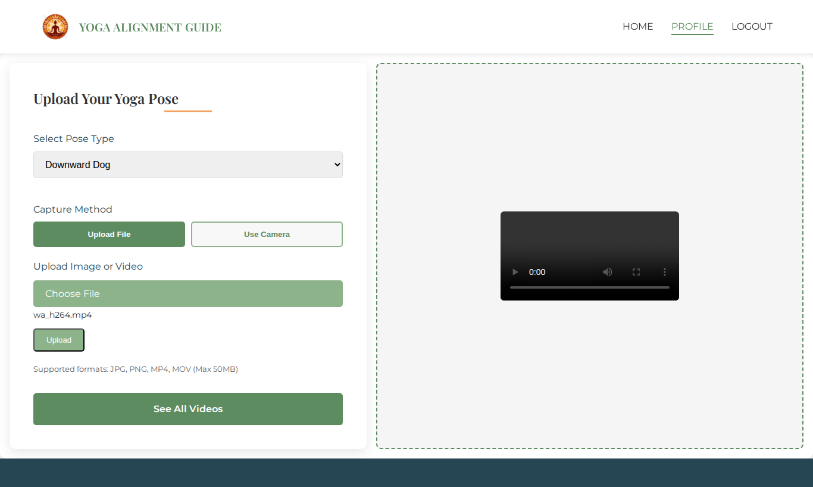
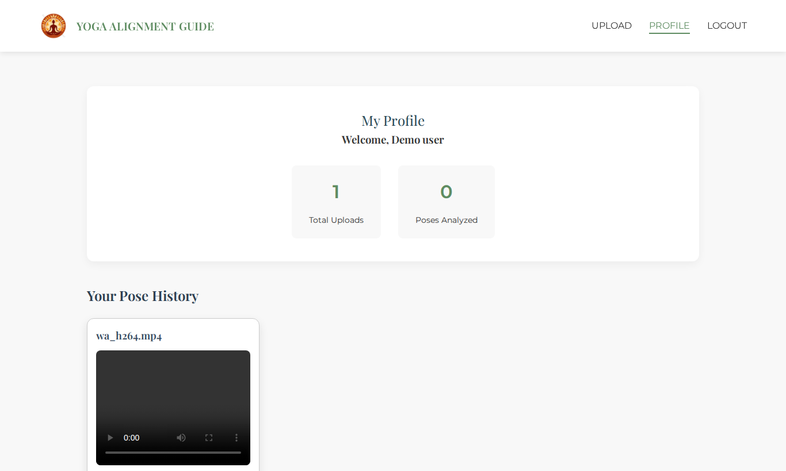
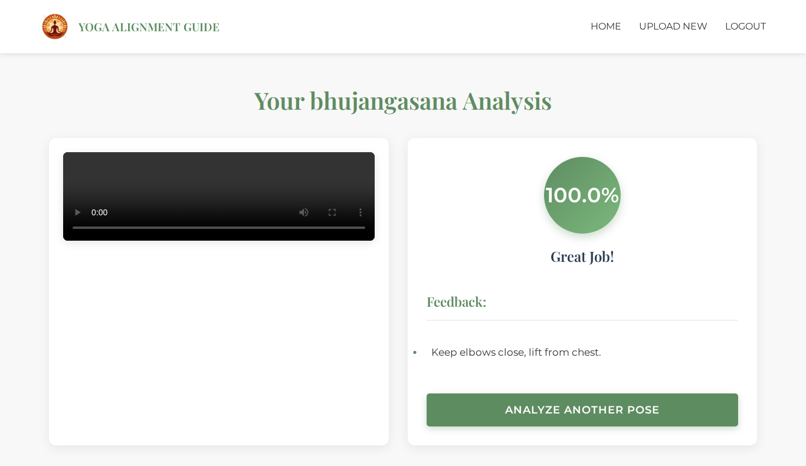
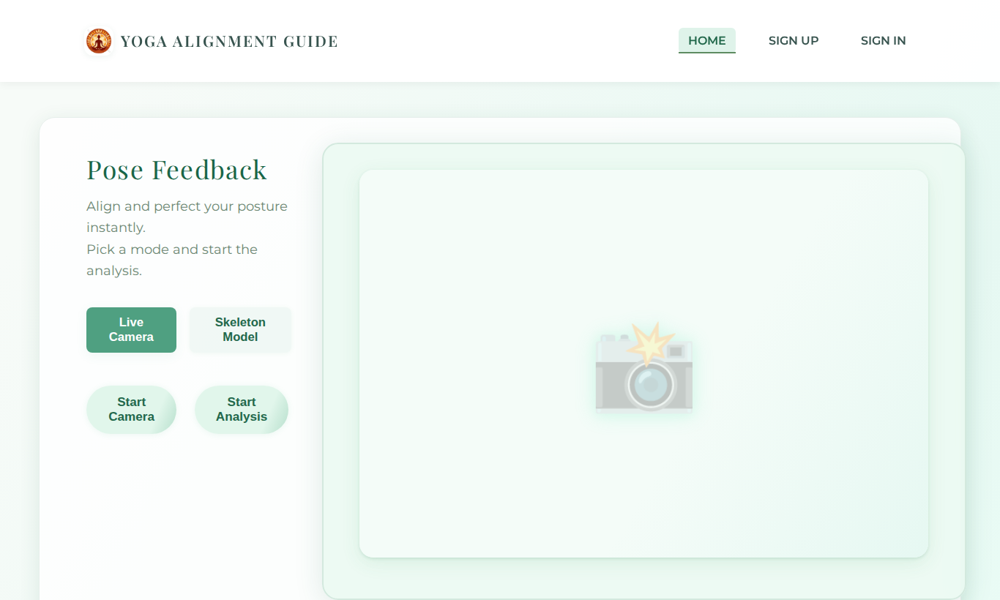
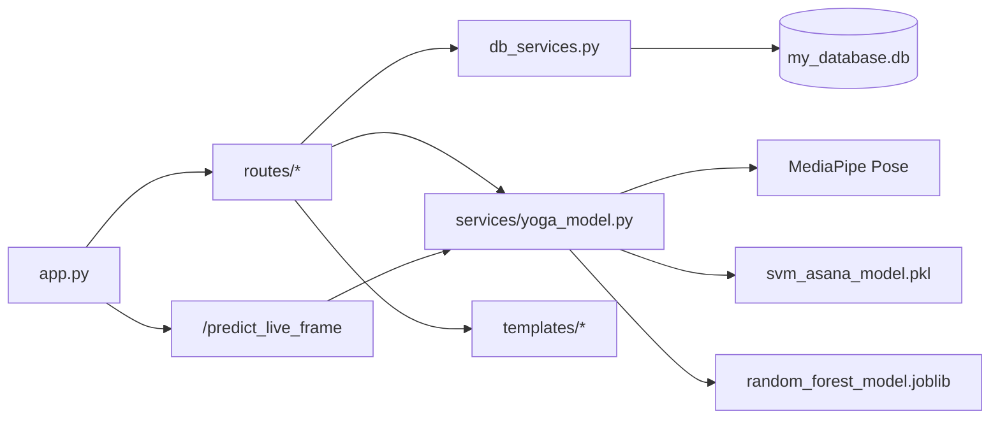
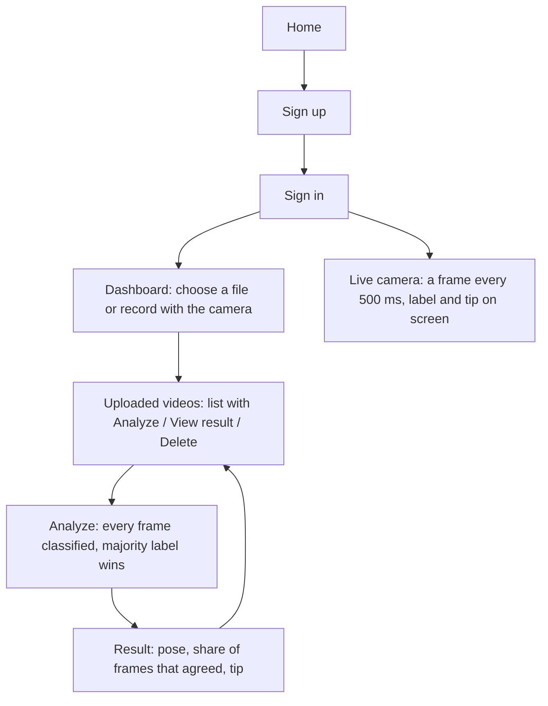
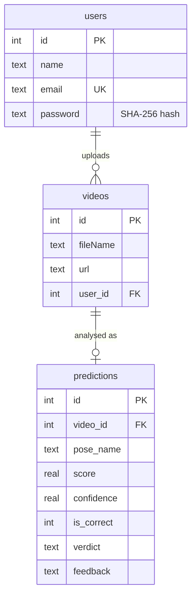
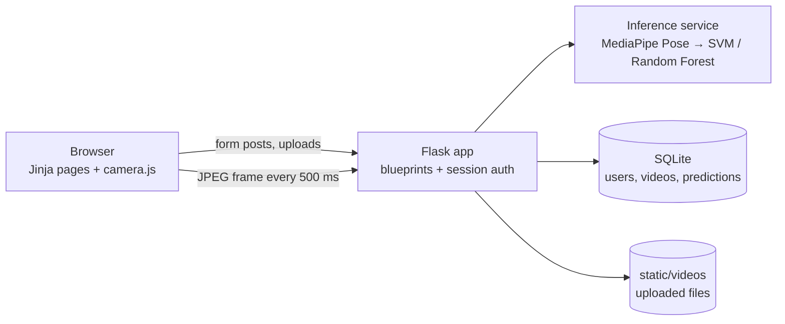

# YogaAlign

**Upload a yoga video, or point your webcam at yourself, and get back which of six asanas you are doing, how consistently you held it, and a correction tip.** MediaPipe finds 33 body landmarks in every frame; two scikit-learn classifiers turn those landmarks into a pose label, one for uploaded videos and one for the live camera.

Built during my AI/ML development internship at AptPath (July to August 2025).

> A learning project, not a fitness or medical product. The classifiers were trained on a small set of poses and the repo has no held-out accuracy number; see [Limits](#limits).

**Contents:** [Problem](#problem-statement) · [Solution](#solution) · [Screenshots](#screenshots) · [File structure](#file-structure) · [User flow](#user-flow) · [LLD](#low-level-design-lld) · [HLD](#high-level-design-hld) · [Scaling](#how-it-would-scale) · [USP](#usp-what-is-different) · [Tools](#tools-and-software-used) · [Principles](#principles-used) · [Requirements](#functional-and-non-functional-requirements) · [Results](#results) · [Run it](#run-it) · [Limits](#limits)

## Problem statement

Most people who practise yoga at home have no one watching them. A pose that looks right from the inside can be off by a lot: hips twisted in Trikonasana, elbows flared in Bhujangasana, weight on the wrong foot in Vrikshasana. A class or a trainer fixes that, but not every day and not for free.

So the question this project answers is narrow:

**"Which pose am I in, did I hold it, and what is the one thing I should check?"**

That sets three requirements:

1. **It has to work from an ordinary phone video or laptop webcam**, with no sensors or special camera.
2. **It has to give an answer per session, not per frame**, because a single frame can be caught mid-transition.
3. **It has to keep a history per user**, so someone can upload a session, come back later and see it again.

## Solution

1. **Sign up and sign in.** Passwords are validated (length, upper case, lower case, digit and symbol) and stored hashed.
2. **Upload or record.** A video file from the dashboard, or a clip recorded in the browser with the webcam (sent as WebM).
3. **Find the body.** MediaPipe Pose returns 33 landmarks for each frame.
4. **Classify every frame.** For uploaded video, the x and y of every landmark (66 numbers) go to an RBF-kernel SVM.
5. **Vote.** The most common label across frames wins. The score is the share of frames that agreed with it; 60% or more counts as a held pose.
6. **Give a tip.** Each pose has one correction cue (for example "Keep elbows close, lift from chest" for Bhujangasana).
7. **Live mode.** The camera page sends a JPEG frame every 500 ms. A 200-tree Random Forest on x, y and visibility (99 numbers) returns the label and its class probability.
8. **Remember it.** Users, videos and predictions are stored in SQLite, so the profile page shows past uploads and their results.

Poses covered: **Bhujangasana, Padmasana, Shavasana, Tadasana, Trikonasana, Vrikshasana.**

## Screenshots

Captured from a local run of this repository (Python 3.11) with a test account and the Bhujangasana sample clip from `static/videos/`.







## File structure

```text
YogaAlign/
├── app.py                      Flask app: config, blueprints, /camera page, /predict_live_frame JSON endpoint
├── models.py                   Pydantic models that validate sign-up and sign-in forms
├── db_connection.py            SQLite connection helper (my_database.db)
├── db_services.py              Creates the 3 tables; CRUD for users, videos and predictions; password hashing
├── requirements.txt            Full pip freeze from the original Windows machine (see Run it for a smaller set)
├── routes/
│   ├── signup_route.py         GET/POST /signup
│   ├── login_route.py          GET/POST /signin, sets the session
│   ├── logout_route.py         /logout
│   └── video_routes.py         /dashboard, /upload, /uploaded-videos, /analyze/<id>, /view_result/<id>, /delete/<id>
├── services/
│   ├── yoga_model.py           MediaPipe landmarks, SVM video pipeline, Random Forest live pipeline, pose tips
│   ├── svm_asana_model.pkl     RBF SVM, 66 features, 6 classes (used for uploaded video)
│   ├── random_forest_model.joblib  Random Forest, 200 trees, 99 features, 6 classes (used for live frames)
│   ├── svm_pose_classifier.pkl Earlier linear SVM on 34 features, kept from experiments, not loaded
│   └── label_encoder.pkl       Label encoder for the 6 class names, not loaded at runtime
├── templates/                  Jinja pages: home, sign up, sign in, dashboard, uploaded videos, results, camera
├── static/
│   ├── css/, js/, images/      Styles, camera and upload scripts, page images
│   └── videos/                 Uploaded videos are saved here (two sample clips are committed)
└── structure.txt               Original folder listing
```

### How the files connect



## User flow



**Explanation.** A user signs in, uploads a session or records one in the browser, then presses Analyze. The result page shows the pose, the frame agreement and the correction tip, and is saved, so it can be opened again from the profile later. The live camera page skips storage and gives feedback while the user holds the pose.

## Low-level design (LLD)

**Uploaded video** (`process_video`):

| Step | What happens |
|---|---|
| Read | OpenCV reads the file frame by frame |
| Landmarks | MediaPipe Pose (`min_detection_confidence=0.3`) returns 33 points; frames with no person are skipped |
| Features | `[x, y]` for each point, flattened to 66 numbers |
| Classify | RBF SVM predicts one of 6 labels per frame |
| Aggregate | Majority label; `score = frames with that label / frames with a person × 100` |
| Verdict | `score >= 60` is shown as held correctly, below that as needs improvement |
| Store | A row in `predictions` (pose, score, verdict, tip), updated if the video is analysed again |

**Live frame** (`process_live_frame`): the browser posts a base64 JPEG, the server decodes it, extracts `[x, y, visibility]` for 33 points (99 numbers), and the Random Forest returns the label and the highest class probability as the score.

**Data model (SQLite):**



## High-level design (HLD)



**Explanation.** One Flask process serves the pages, stores uploads on disk and runs inference in the request. Everything runs on CPU; there is no separate model server or queue.

## How it would scale

| Concern | Today | Next step |
|---|---|---|
| Inference | Runs inside the web request, about 36 ms per frame on 2 CPU cores, so a 30 s clip blocks the request for around 30 s | Move analysis to a background worker (Celery or RQ) and poll for the result |
| Live mode | Full-size JPEG uploaded every 500 ms | Run MediaPipe in the browser (MediaPipe Tasks for Web) and send only the 99 landmark numbers |
| Storage | SQLite file and local `static/videos` | Postgres and object storage (S3 or similar) |
| Model | 6 poses, no training pipeline in the repo | Add the training notebook, a held-out test set and more poses |
| Feedback | One fixed tip per pose | Joint-angle checks per pose (for example elbow angle in Bhujangasana) so the tip matches what is actually wrong |

## USP: what is different

| Feature | Common approach | What this does |
|---|---|---|
| Input | A single photo | Whole videos, a browser-recorded clip or a live camera |
| Stability | One prediction per frame | Majority vote across the session, so transition frames don't decide the label |
| Two paths | One model for everything | A model per path: SVM for offline video, Random Forest with class probabilities for live frames |
| History | Stateless demo | Per-user accounts with saved uploads and results |

## Tools and software used

| Tool | Used for | Why this one |
|---|---|---|
| **Flask, Jinja2** | Web app, pages, sessions | Small, quick to build multi-page apps |
| **MediaPipe Pose** | 33 body landmarks per frame | Runs in real time on CPU, no GPU needed |
| **OpenCV** | Reading video, decoding camera frames | Standard for frame-by-frame video work |
| **scikit-learn** | SVM and Random Forest classifiers | Small models that train and load fast on landmark features |
| **Pydantic** | Form validation | Typed validation with clear error messages |
| **SQLite** | Users, videos, predictions | Zero setup for a single-machine app |
| **HTML, CSS, JavaScript** | Pages, upload preview, camera capture | No front-end build step |

## Principles used

* **Landmarks, not pixels.** Classifying 66 or 99 coordinates instead of raw images keeps the models small and less sensitive to clothes, lighting and background.
* **Decide per session.** A majority vote over frames is more stable than any single frame.
* **Keep paths separate.** Offline video and live camera have different constraints, so each has its own model and feature set.
* **Validate at the edge.** Sign-up and sign-in input is checked by Pydantic models before it touches the database.

## Functional and non-functional requirements

**Functional**

| Requirement | How it is implemented |
|---|---|
| Accounts | `/signup`, `/signin`, `/logout`, Flask session |
| Upload or record | Dashboard form (`file`) or browser recording (`camera-video-data`, WebM) |
| Classify a video | `/analyze/<id>` → `process_video` |
| Live feedback | `/camera` page → `/predict_live_frame` |
| History | `/uploaded-videos`, `/view_result/<id>`, `/delete/<id>` |

**Non-functional**

| Quality | How it is handled |
|---|---|
| Runs on a laptop | CPU only; measured 36 ms per video frame and 61 ms median per live frame on 2 cores |
| Robust to missing people | Frames with no landmarks are skipped; a video with none returns "No pose detected" |
| Input validation | Pydantic rules for email and password; `secure_filename` on uploads |
| Data separation | Video lists, analysis and deletion are filtered by the signed-in user's id (see Limits for one gap) |

## Results

There is no held-out accuracy figure in this repo: the training data and notebook were not committed, so I can't reproduce one and don't claim one. What I did measure, on the code as it is here (Python 3.11, 2 CPU cores, no GPU):

| What | Result |
|---|---|
| Sample Bhujangasana clip (`static/videos/WhatsApp_Video_...mp4`, 545 frames) | Labelled **Bhujangasana**, 100% of frames agreed |
| Video analysis speed | 545 frames in 19.5 s, about **36 ms per frame** |
| Live frame round trip inside the server (1366×768 frame) | **61 ms median**, 73 ms p90 |
| Sample Tadasana clip (a presenter talking, then demonstrating) | Labelled **Trikonasana** (86% of frames). Most frames are not a held pose, which the model was never trained to reject |

## Run it

The committed `requirements.txt` is a full freeze from a Windows machine and includes Windows-only packages (`tensorflow_intel`), so on Linux or macOS install just what the app imports:

```bash
git clone https://github.com/Asha0509/YogaAlign.git
cd YogaAlign
python3.11 -m venv .venv && source .venv/bin/activate      # Windows: .venv\Scripts\activate
pip install Flask==3.1.1 mediapipe==0.10.21 numpy==1.26.4 scikit-learn==1.7.1 \
            joblib==1.5.1 opencv-python-headless pydantic==2.11.7
python app.py                                              # http://127.0.0.1:5000
```

Tables are created on start-up. Sign up, then upload a clip from the dashboard.

## Limits

- **No reproducible accuracy.** Training code and data are not in the repo, so there is no test-set number to quote. The models cover 6 poses.
- **The score is agreement, not correctness.** "100%" means every frame got the same label, not that the pose was performed well. The tip is a fixed cue per pose, not a measurement of the user's joints.
- **No "not a yoga pose" class.** Any person in frame gets one of the 6 labels, which is why the talking-presenter Tadasana clip comes out as Trikonasana.
- **The pose dropdown on the dashboard is not used.** The classifier decides the pose; what the user picks is ignored.
- **Codecs.** The committed Tadasana sample is AV1; some OpenCV builds can't decode AV1 and report "No pose detected". Re-encoding to H.264 (`ffmpeg -i in.mp4 -c:v libx264 out.mp4`) fixes it.
- **Security is demo-grade.** The Flask secret key is hard-coded, passwords use unsalted SHA-256 rather than bcrypt or argon2, the debug server is used, and `/view_result/<id>` does not check that the result belongs to the signed-in user.
- **Repo hygiene.** `__pycache__`, a local database snapshot and sample videos were committed with the original project.
